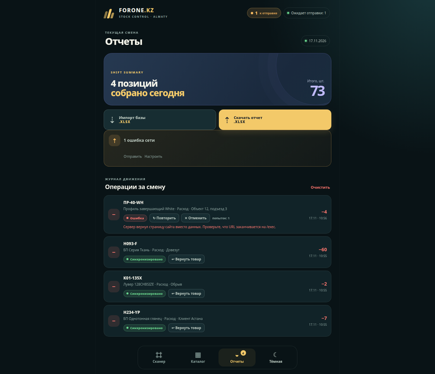
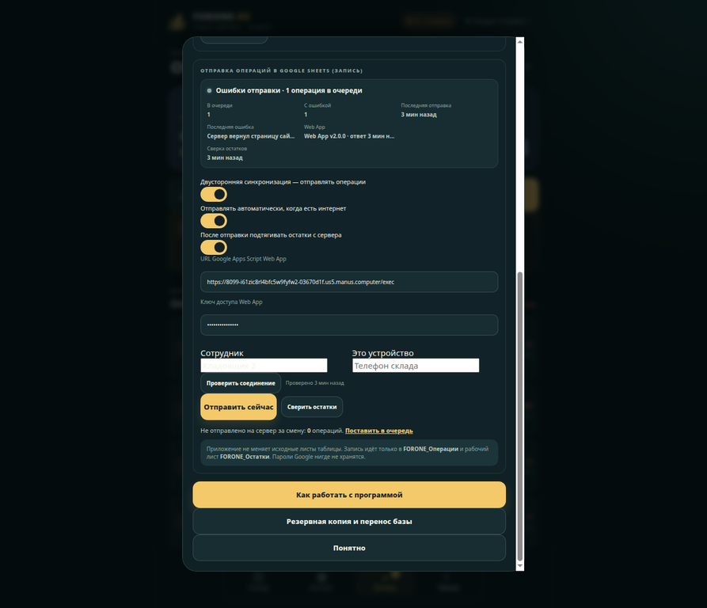

# Двусторонняя синхронизация с Google Таблицей

Документ о том, как телефонный склад FORONE.KZ обменивается данными с Google Таблицей:
установка серверной части, протокол, правила сопоставления позиций, поведение при обрыве
связи и разбор типовых ситуаций.

## 1. Схема обмена

```
Телефон кладовщика                     Google Таблица FORONE
┌────────────────────────┐            ┌──────────────────────────────┐
│ app.js                 │   POST     │ FORONE_Sync_v2.gs (Web App)  │
│  · операции смены      │ ─────────▶ │  · doGet  ping / stock       │
│  · очередь sync-queue  │  операции  │  · doPost операции           │
│                        │ ◀───────── │  · LockService, журнал       │
│ FORONE_Остатки (локаль)│   GET      ├──────────────────────────────┤
│ localStorage           │ ◀───────── │ Октябрь-Ноябрь  ← чтение     │
└────────────────────────┘  остатки   │ FORONE_Остатки  ← рабочий    │
                                      │ FORONE_Операции ← журнал     │
                                      │ FORONE_Ошибки   ← инциденты  │
                                      └──────────────────────────────┘
```

Три канала, и они не мешают друг другу:

1. **Односторонний импорт (только чтение)** — прежняя схема: приложение читает лист-источник
   и обновляет каталог. Исходные листы таблица не меняет никогда.
2. **Двусторонняя синхронизация (запись)** — новый канал: операции телефона пишутся в лист
   `FORONE_Операции`, а рабочий лист `FORONE_Остатки` становится источником истины по остаткам.
3. **Офлайн** — при отсутствии интернета операции копятся в локальной очереди и уходят
   позже без напоминаний.

## 2. Установка серверной части (10 минут)

1. Откройте таблицу FORONE → **Расширения → Apps Script**.
2. Создайте файл `FORONE_Sync_v2.gs` и вставьте в него содержимое одноимённого файла проекта.
   Если в проекте уже есть старые скрипты с функциями `doGet` / `doPost` — удалите эти
   функции из старых файлов (в проекте должна остаться одна точка входа), иначе Apps Script
   не соберётся.
3. **Проектные настройки → Свойства скрипта (Script Properties)** добавьте:

   | Ключ | Пример | Зачем |
   | --- | --- | --- |
   | `FORONE_SHARED_SECRET` | `kz-forone-2f9c17a4be` | Ключ доступа. Пока не задан — Web App принимает запросы без ключа (только для отладки) |
   | `FORONE_ALLOWED_USERS` | `Кладовщик 1,Диспетчер` | Необязательно: пустое значение = разрешены все |
   | `FORONE_SPREADSHEET_ID` | `1fanDUG…` | Необязательно: по умолчанию берётся id открытой таблицы |

   Ключ сгенерируйте длинный (20+ символов) и храните в секретаре: он единственная защита
   адреса `/exec`.
4. Запустите функцию **`FORONE_setup()`** (кнопка «Run», разрешите доступ). Она создаёт листы
   `FORONE_Остатки`, `FORONE_Операции`, `FORONE_Ошибки` с нужными заголовками и формулами.
   Исходный лист-месяц не трогается.
5. Запустите **`FORONE_selfTest()`** — внутренний набор проверок логики. Внизу должен быть
   написан итог без провалов.
6. **Развертывание → Новый версия → Веб-приложение**:
   * Запуск от имени: **я (владелец)**;
   * Доступ: **все** (иначе телефон без аккаунта Google не сможет отправить операцию;
     безопасность держится на ключе, а не на входе);
   * Сохраните URL вида `https://script.google.com/macros/s/AKfyc…/exec`.
7. На телефоне: `ⓘ` → блок **«Отправка операций в Google Sheets (запись)»** → вставьте URL и
   ключ → включите «Двусторонняя синхронизация» → **Проверить соединение**. Должно появиться
   `Связь есть · Web App v2.0.0 · позиций N`.
8. Нажмите **Сверить остатки** — телефон заберёт рабочие остатки склада.

Обновление кода скрипта: **Развертывания → Изменить версию → New version**. Старый `/exec`
продолжает работать, телефоны ничего не перенастраивают.

## 3. Листы таблицы

| Лист | Кто пишет | Содержание |
| --- | --- | --- |
| `Октябрь-Ноябрь` (и другие месяцы в `FORONE_CONFIG.sourceSheets`) | бухгалтер | Артикул, название, категория, длина, остаток на складе |
| `FORONE_Остатки` | скрипт | Рабочий остаток: источник + все операции. Колонки `Артикул … Резерв, Доступно (=остаток−резерв), Источник, Последняя операция, Обновлено, Расхождение` |
| `FORONE_Операции` | скрипт | Журнал: ID операции, дата, артикул, название, тип, количество, изменение остатка, пользователь, устройство, комментарий, **Статус**, **Ошибка**, Остаток после, Источник |
| `FORONE_Ошибки` | скрипт | Служебные сбои: нечитаемый запрос, конфликт блокировки, падение скрипта |

Рабочий лист пересчитывается так: `остаток_рабочий = остаток_источника + Σ применённых операций`.
Изменения источника (подвезли/списали руками) скрипт относит как разницу, а операции
остаются в журнале навсегда — это и есть аудируемый след.

## 4. Протокол

Все запросы — к одному `/exec`. Ответ всегда JSON.

### 4.1 Проверка соединения

```
GET /exec?action=ping&key=…
{
  "ok": true, "app": "FORONE-SYNC", "version": "2.0.0",
  "serverTime": "…", "timeZone": "Asia/Almaty",
  "spreadsheet": { "id": "…", "name": "…", "url": "…" },
  "sheets": { "FORONE_Остатки": 5, "FORONE_Операции": 12, "FORONE_Ошибки": 0 },
  "auth": { "secretRequired": true, "allowedUsers": [] }
}
```

### 4.2 Загрузка рабочих остатков

```
GET /exec?action=stock&key=…
{ "ok": true, "serverTime": "…",
  "products": [ { "sku": "H234-YP", "name": "БП Однотонная глянец", "category": "Панель",
                  "length": 3000, "stock": 38, "reserve": 0, "available": 38,
                  "warehouse": "Алматы", "zone": "", "rack": "", "bin": "",
                  "lastOp": "op-…", "updatedAt": "…", "conflict": "" } ],
  "conflicts": [] }
```

`conflict` непустой, если на складе заметили расхождение источника и журнала — приложение
показывает такой лист в блоке «Расхождения».

### 4.3 Отправка операций

```http
POST /exec
Content-Type: text/plain;charset=utf-8

{
  "action": "operations", "key": "…", "app": "FORONE Stock",
  "user": "Кладовщик 2", "device": "dev-mwkk7cy1-fwc0",
  "operations": [
    { "operationId": "op-20261117-103859-408-hqg4",
      "sku": "H234-YP", "name": "БП Однотонная глянец", "category": "Панель",
      "type": "out", "qty": 7, "comment": "Клиент Астана",
      "createdAt": "2026-11-17T10:38:59.408Z" }
  ]
}
```

```json
{ "ok": true, "serverTime": "…", "received": 1, "applied": 1, "duplicates": 0, "rejected": 0,
  "results": [ { "operationId": "op-…", "ok": true, "status": "processed",
                 "sku": "H234-YP", "matchedName": "БП Однотонная глянец", "ambiguous": false,
                 "stockBefore": 45, "stockAfter": 38, "reserve": 0, "availableAfter": 38,
                 "retriedAfterRejection": 1 } ] }
```

`ambiguous: true` — артикул встречается в таблице несколько раз, и позиция выбрана по
названию/категории. Проверьте строку в журнале, если название расходится с тем, что на этикетке.

## 5. Как приложение находит позицию

Ключевое правило: **артикул сам по себе не уникален**. В базе FORONE `H234-YP` — это и
«Лувер 226YHB», и «БП Однотонная глянец». Ошибка сопоставления в такой ситуации означает
списание не той позиции, поэтому:

* **Сервер** (`pickStockRow_`) перебирает строки с нужным артикулом и выбирает:
  1. точное совпадение названия и категории;
  2. строку, где остатка хватает на операцию;
  3. если подходящих несколько — берёт первую и помечает ответ `ambiguous`.
* **Телефон** (`sync-queue.js → matchProduct`) при слиянии серверных остатков идёт в три
  прохода:
  1. точное совпадение «артикул + название + категория»;
  2. тот же артикул и ровно одна свободная строка — считаем, что позицию переименовали;
  3. иначе добавляем новую позицию (дубль артикула остаётся дублем, ничего не схлопывается).
* Позиции, по которой у телефона есть **неотправленная** операция, серверные цифры не
  перезаписывают: иначе собственный расход потерялся бы при сверке.

Если сопоставить не удалось, операция на сервер уйдёт (журнал всё равно полный), а телефон
покажет предупреждение «позицию не удалось сопоставить — сверьте остатки» и не тронет чужую
строку.

## 6. Очередь, статусы и повторы

Каждая операция смены живёт в двух местах: в журнале смены (`Операции за смену`) и в очереди
отправки. Статусы:

| Статус | Значение | Что делает приложение |
| --- | --- | --- |
| **Локально** | Синхронизация выключена | Ждёт, пока её включат; при включении можно дослать кнопкой «Поставить в очередь» |
| **В очереди** | Не отправлено | Уходит автоматически при появлении интернета |
| **Отправка** | Пакет в пути | Повторный запуск не создаёт второй пакет |
| **Синхронизировано** | Склад провёл операцию | Кнопка «↩ Вернуть товар» создаёт обратную операцию |
| **Ошибка** | Сбой канала или ответа | Автоповтор: 10 с → 30 с → 2 мин → 10 мин → 30 мин. Кнопки «↻ Повторить» и «✕ Отменить» |
| **Отклонено** | Склад не принял данные | Автоматически НЕ повторяется. «↻ Отправить снова» (когда причина устранена) или «Убрать» |
| **Отменено** | Операцию убрали из очереди | Остаток на телефоне восстановлен |

Индикаторы: жёлтая пилюля «N к отправке» в шапке, баннер в отчётах
(«1 ошибка сети · 1 операция отклонена складом»), строка состояния в карточке синхронизации,
причина ошибки прямо в строке журнала.

```
Очередь → пакет ≤ 50 операций → POST /exec
   ↑              ↓ нет ответа / HTML вместо JSON
 автоповтор    статус «Ошибка», пауза по нарастающей
```

### Идемпотентность

`operationId` формируется из времени, порядкового номера внутри секунды и случайного хвоста —
два телефона не генерируют одинаковый идентификатор. Сервер держит два раздельных набора:

* **применённые** ID: повтор не меняет остаток, ответ `duplicate`;
* **отклонённые** ID: тот же запрос с теми же данными принимается, когда склад устранит
  причину (подвезёт товар, добавит артикул); в журнале остаются обе строки — «Отклонено» и
  «Обработано», а ответ помечен `retriedAfterRejection`.

Если под тем же ID придут **другие** данные (другое количество или артикул), это считается
повтором уже записанной операции и не применяется.

## 7. Типовые ситуации

**Нет интернета / склад без связи.** Работает как раньше: сканирование, приход, расход,
отчёты. Операции копятся, пилюля показывает счёт. Как только связь появляется — всё уходит
само, проверять вручную не нужно.

**Сервер вернул страницу вместо данных.** Обычно URL введён без `/exec` или приложение
опубликовано без права «Все». Сообщение об этом показывается дословно.

**«Недостаточно доступного остатка».** На складе товара меньше, чем думает телефон. Операция
не проведена, остаток телефона не изменился со стороны сервера. Варианты: довести товар и
нажать «↻ Отправить снова»; убрать операцию и оформить заново на реальное количество;
или «Сверить остатки», чтобы телефон пересчитался по складу.

**«Артикул не найден в листе FORONE_Остатки».** Новую позицию добавили в месяц-источник, но
рабочий лист ещё не обновлён. Нажмите «Сверить остатки» или попросите бухгалтера запустить
`syncForoneStock` в редакторе скриптов.

**Две позиции с одним артикулом.** Обе остаются в каталоге отдельными строками; при поиске и
сканировании выбирайте нужную по названию, в карточке операции видно название позиции.

**Операция сделана до включения синхронизации.** В карточке есть строка «Не отправлено на
сервер за смену: N операций» и кнопка «Поставить в очередь» — она берёт только операции со
статусом «Локально», никогда не отклонённые и не отменённые.

**Перенос на другой телефон.** «Резервная копия и перенос базы» сохраняет каталог, журнал и
очередь. Порядок: на старом телефоне дождаться пустой очереди → выгрузить JSON → на новом
восстановить → включить синхронизацию и ввести ключ.

## 8. Безопасность

* Ключ доступа (`FORONE_SHARED_SECRET`) сверяется на каждом запросе; без него — 401 `AUTH`.
  Телефон хранит ключ только в localStorage своего браузера, аккаунты Google нигде не запрашиваются.
* Веб-приложение исполняется от владельца таблицы: телефону не нужны права на таблицу и
  пароли. Доступ «Все» означает «любой, у кого есть URL и ключ».
* `FORONE_ALLOWED_USERS` позволяет сузить круг: операции от незнакомых имён пользователей
  отклоняются с `FORBIDDEN_USER`.
* Потерялся телефон — смените `FORONE_SHARED_SECRET` и опубликуйте новую версию; старые
  устройства перестанут писать, пока не получат новый ключ.
* Исходные листы месяца скрипт читает, но никогда не перезаписывает.

## 9. Быстрая проверка связи

```bash
# версия и число позиций
curl -s "https://script.google.com/macros/s/AKfyc…/exec?action=ping&key=ВАШ_КЛЮЧ"

# рабочие остатки
curl -s "…/exec?action=stock&key=ВАШ_КЛЮЧ"

# одна операция (безопасно: повтор не меняет остаток)
curl -s -X POST "…/exec" -H "Content-Type: text/plain" -d '{
  "action":"operations","key":"ВАШ_КЛЮЧ","user":"Проверка","device":"curl",
  "operations":[{"operationId":"check-1","sku":"H234-YP","type":"out","qty":1,
                 "name":"БП Однотонная глянец","category":"Панель"}]}'
```

Локально, без Google, тот же код Apps Script поднимается учебным сервером:
`node tests/mock-webapp.js 8099` (описание — в [`TESTING.md`](TESTING.md)).

## 10. Экраны

Журнал смены с неотправленной операцией, кнопками повтора и отмены, баннером и пилюлей:



Карточка «Информация о приложении» — блок двусторонней синхронизации:


